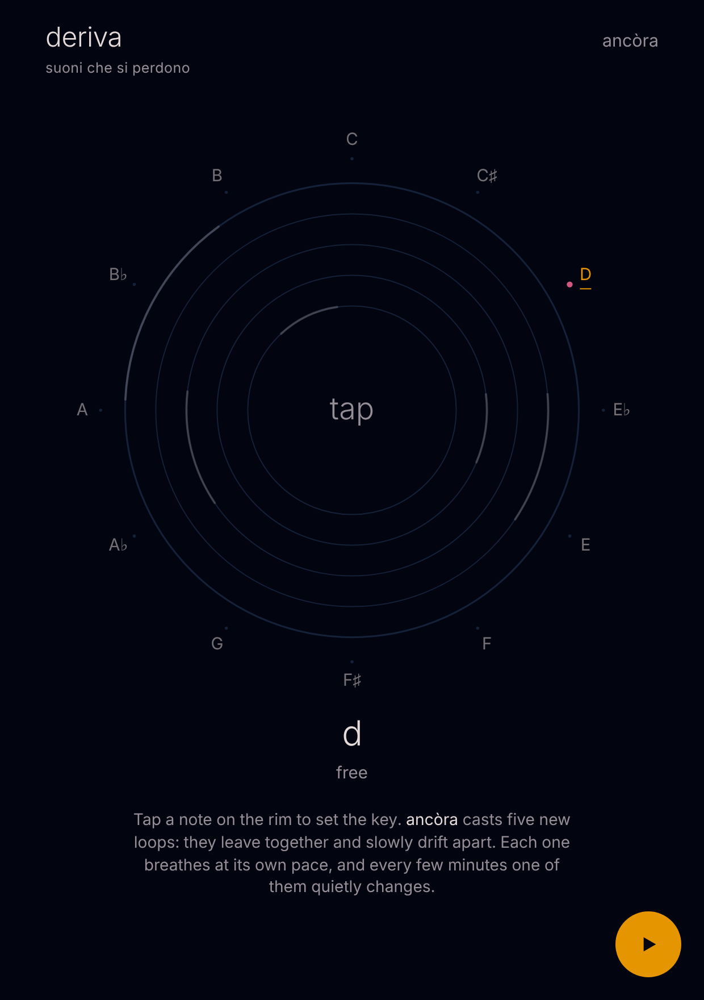

# deriva

*suoni che si perdono*

A Buddha Machine for the browser. Five short loops, tuned to the key you choose, leave together and slowly drift apart. One HTML file and a folder of sounds, no dependencies, no install.

**▶ Play it: [phonk.github.io/deriva](https://phonk.github.io/deriva/)**

## Play

There are only three things to touch.

- **play** (the round button, or tap the centre of the dial) starts and stops the sound.
- **the rim** holds the twelve notes: tap one to set the key. Everything glides to it like tape.
- **ancòra** casts five new loops and a new mode. They all start at the same instant, then drift.

Under the dial you read the key and the mode the loops were chosen for, so you know which scale to play over them.

## How it drifts

Every loop is a whole number of seconds long, and the lengths are primes: 3, 5, 7, 11, 13, 17, 19, 23, 29. Loops that start together come back into line only after the product of their lengths, which is hours or days. On the dial each ring is a loop and its amber arc shows where it is: you watch them leave the top together and spread out.

## The five rings

From the outside in, each ring has a role, and ancòra only draws from the sounds that suit it.

| ring | role | sounds | breathes every | quietest |
|---|---|---|---|---|
| 1 | ground | drones, tanpura, harmonium, shruti box | ~83 s | 40% |
| 2 | voice | hummed choir, organ, singing glass, pads | ~61 s | 12% |
| 3 | strikes | bells, singing bowls | ~47 s | 15% |
| 4 | air | rain, rivers, sea, forest, birds, a temple, wind | ~71 s | 25% |
| 5 | guest | one more colour, on only half the time | ~37 s | 5% |

**Breathing.** Each loop has its own very slow volume LFO, each with a different period and phase, so the drones never sit still in front of you.

**Evolution.** Every two or three minutes one thing changes: usually one loop is swapped for another of the same role, chosen while it is at its quietest and crossfaded over ten seconds; sometimes the guest comes or goes. The key never changes on its own.

**Tone.** Everything runs through a lowpass filter that slowly opens and closes (one sweep every 97 s, roughly 2–5 kHz), over a low bed of brown noise and a faint hiss, into a long dark reverb (about 6 s). A touch of tape wow and flutter and a soft saturation give it the small-speaker character of the original.

## Keys and modes

Every sampled loop was analysed offline: its fundamental and the offset in cents, plus the notes it contains. The app transposes each loop to the nearest position of the key (never more than a tritone), corrected to the cent. In a mode other than free, a loop is only used if all its notes fall inside the scale.

Modes ancòra draws from: free (most often), dorian, minor pentatonic, major pentatonic, minor, mixolydian, lydian.

## Sounds

81 loops, mono WAV at 22 kHz, cut so that they close without a seam.

- **Generated:** 9 loops synthesised for deriva: harmonic drone, tanpura, pentatonic bells, a dorian phrase, a hummed choir, bowed metal, wind, a small organ, whistled harmonics.
- **Freesound**, CC0 previews, by: Aerotek, Anthousai, armandem, bassimat, BJCurlee, cabled_mess, deadrobotmusic, decembered, el_boss, eliasheuninck, envirOmaniac2, EphJayMusic, f-r-a-g-i-l-e, fauxpress, Hano_van_Dalen, iluppai, itinerantmonk108, Johnnie_Holiday, LilMati, luckylittleraven, MieliTietty, mooncubedesign, mttvn, Nickisawsome74, oceansonmars, RutgerMuller, s-light, Seth_Makes_Sounds, ShangusBurger, skylarjulian, solarpsychedelic, soundjoao, spectral9, Spoodlesby, steprock, TSP-Talk, xkeril.
- **Field recordings** from the Japan pack by [freetousesounds](https://www.freetousesounds.com): rivers, sea, forest, birds and Asakusa temple.

## Origin

The Buddha Machine is a small plastic loop player made by FM3 in 2005, after the chanting boxes sold in Chinese temples. deriva keeps its idea, a few loops that never quite meet, and adds what makes it useful to play over: every sound in one key.
